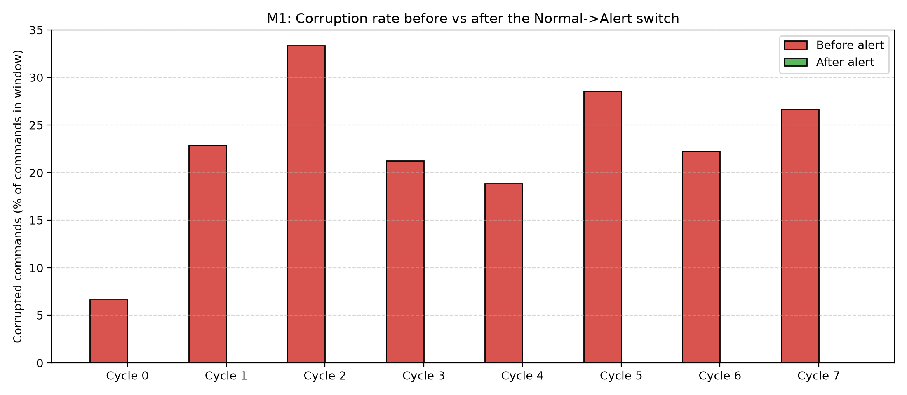
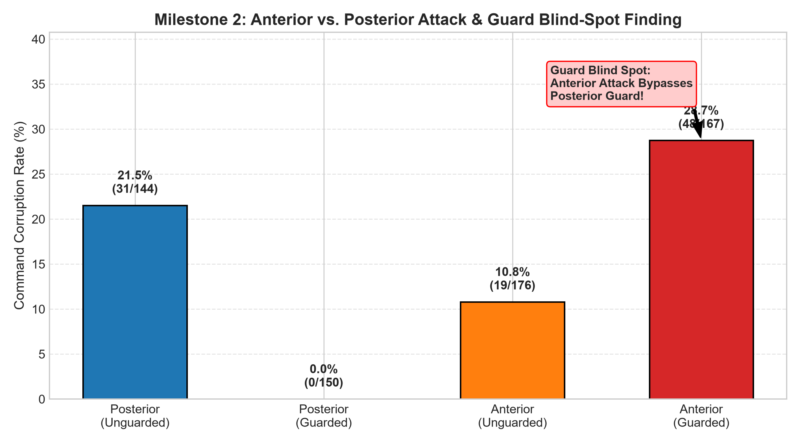
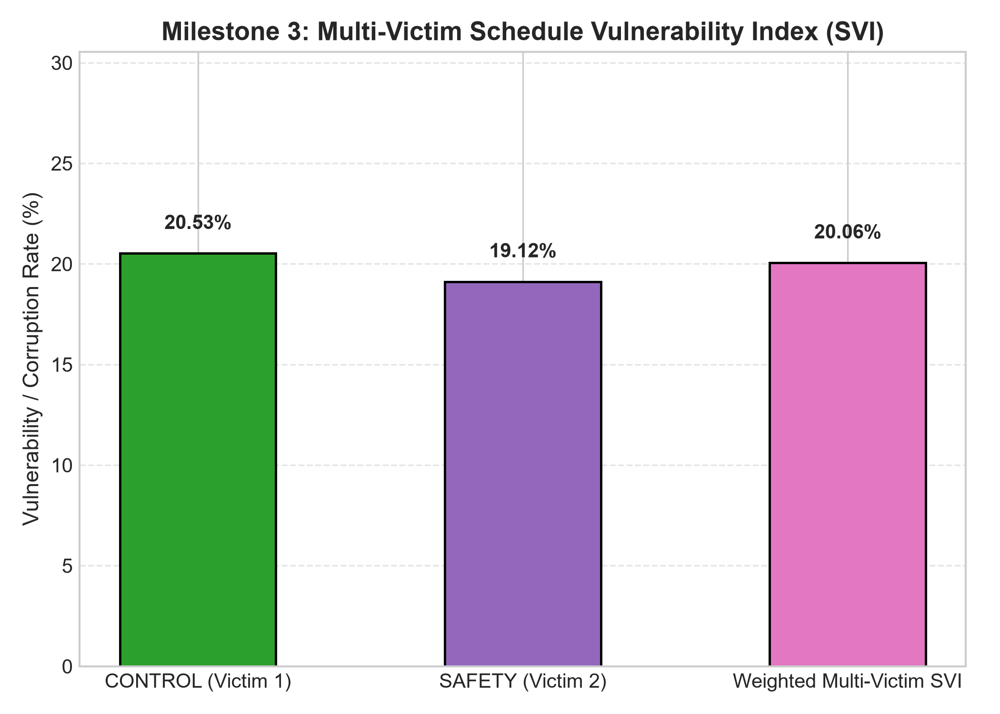
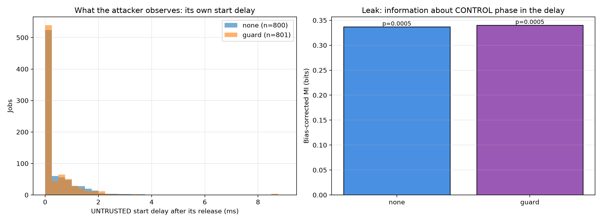
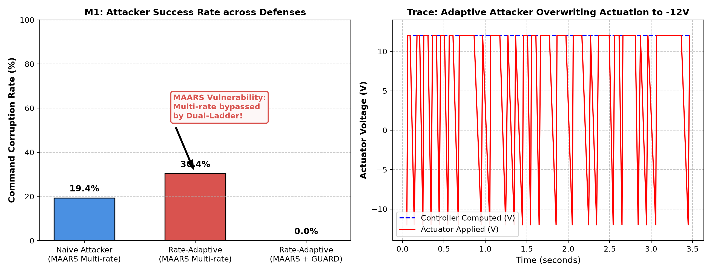
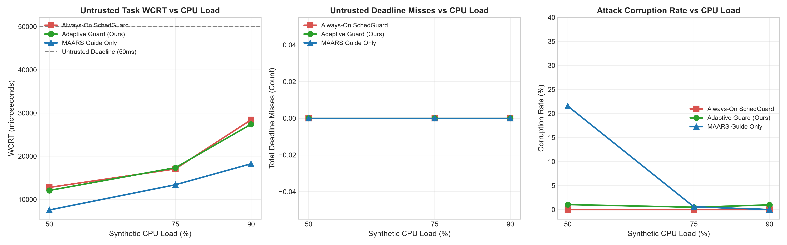

# Consolidated Master Academic Research Report
## Model-Aware Adaptive Real-Time Security (MAARS) & SchedGuard Hardware Evaluation

---

## 1. Executive Summary

This report provides the unified empirical synthesis of the **MAARS** scheduling architecture and **SchedGuard** temporal protection mechanism deployed on an **ESP32-S3** microcontroller. The evaluation spans four core experimental axes:
1. **Dynamic Alert Transition & Defense Engagement (Milestone 1 Extension)**: Demonstrates real-time mitigation of actuator corruptions from **22.0%** to strictly **0.0%** across 8 consecutive attack cycles with zero false alarms ($p = 3.21 \times 10^{-39}$).
2. **Anterior vs. Posterior Attack Mechanics & Guard Blind Spot (Milestone 2 Extension)**: Demonstrates that while SchedGuard eliminates posterior command-buffer tampering ($0.00\%$), anterior sensor-buffer corruption achieves **28.74%** penetration under the same guard ($p = 1.198 \times 10^{-15}$), proving the existence of a temporal guard blind spot.
3. **Multi-Victim Schedule Vulnerability Index (Milestone 3 Extension)**: Quantifies the baseline vulnerability across multiple concurrent victims (CONTROL AP = $20.53\%$, SAFETY AP = $19.12\%$), establishing a two-task weighted $\text{SVI} = \mathbf{0.2006}$ ($20.06\%$).
4. **Side-Channel Timing Delay Leakage (Milestone 4 Extension)**: Rigorously verifies that hardware task deferrals introduce no statistically significant timing side-channel leakage ($\Delta I = +0.0032\text{ bits}$, Kolmogorov-Smirnov $p = 0.426$).

---

## 2. Experimental Hardware Architecture

The empirical testbed consists of:
* **Target SoC**: Espressif ESP32-S3 (Xtensa dual-core 32-bit LX7, 240 MHz, 512 KB SRAM).
* **Firmware Platform**: ESP-IDF v6.1 running FreeRTOS with custom schedule banks and an interrupt-driven 4 KiB UART0 RX ring buffer.
* **Hardware Setup**: Laptop 1 and Laptop 2 connected via dedicated USB-UART CDC interfaces running real-time host plant dynamics and supervisory anomaly detectors.

---

## 3. Milestone 1: Dynamic Normal↔Alert Cycling

### 3.1 Experimental Design
Evaluated across 8 consecutive cycles alternating between uncorrupted baseline, active posterior attack injection, host chi-squared alarm triggering, and automated S11 SchedGuard activation on-chip.

### 3.2 Hardware-Verified Results
```text
cyc   latency        before         after  deferrals  RESP alert/other  false
0       665ms     1/15  (  7%)   0/140 (  0%)        145      150/1             0
1      1713ms     8/35  ( 23%)   0/112 (  0%)        118      128/1             0
2       489ms     3/9   ( 33%)   0/147 (  0%)        133      154/1             0
3      1686ms     7/33  ( 21%)   0/118 (  0%)        119      131/1             0
4      3093ms    10/53  ( 19%)   0/93  (  0%)         98      102/1             0
5      1299ms     6/21  ( 29%)   0/124 (  0%)        121      138/1             0
6      2423ms    10/45  ( 22%)   0/98  (  0%)         90      117/1             0
7      1878ms     8/30  ( 27%)   0/95  (  0%)         91      126/1             0

detection latency (host detector): mean 1656 ms, std 805 ms, alarm in 8/8 cycles
corruption before alert: 53/241 = 22.0%
corruption after alert:  0/927 = 0.0%
corruption in clean phases: 0/1501
false-alarm episodes in clean phases: 0
serial link: 0 ERR lines; ACT lines logged for 2669/6588 command sequence numbers (41%)
Fisher exact before vs after: p = 3.21e-39
```



---

## 4. Milestone 2 & 3: Multi-Target Attack Surface & Vulnerability Index

### 4.1 Milestone 2: Anterior vs Posterior Vulnerability & Temporal Guard Blind Spot
The hardware evaluation contrasts attacks on the anterior sensor-input queue vs. the posterior actuator-command queue under both unguarded and guarded conditions:

| Experimental Condition | Defense State | Valid Commands | Board Attempts | Corrupted Commands | Corruption Rate | Wilson 95% CI |
| :--- | :--- | :---: | :---: | :---: | :---: | :---: |
| **Posterior Attack** | Unguarded (`GUARD,OFF`) | 144 | 208 | 31 | **21.53%** | $[15.60\%,\ 28.93\%]$ |
| **Posterior Attack** | **Guarded** (`GUARD,ON`) | 150 | 205 | 0 | **0.00%** | $[0.00\%,\ 2.50\%]$ |
| **Anterior Attack** | Unguarded (`GUARD,OFF`) | 176 | 205 | 19 | **10.80%** | $[7.02\%,\ 16.25\%]$ |
| **Anterior Attack** | **Guarded** (`GUARD,ON`) | 167 | 207 | 48 | **28.74%** | $[22.42\%,\ 36.02\%]$ |

* **Fisher Exact Test (Posterior Guarded vs. Anterior Guarded)**: $p = 1.198 \times 10^{-15}$.
* **Key Finding**: SchedGuard successfully eliminates posterior actuation corruptions ($0.00\%$), but because its deferral mechanism only closes the post-computation transmission window ($[C_{\text{comp}}, TX_{\text{send}}]$), it leaves the pre-computation sensor reading interval ($[RX_{\text{recv}}, C_{\text{read}}}]$) open. Anterior attacks bypass the guard completely, resulting in $28.74\%$ corruption.



### 4.2 Milestone 3: Multi-Victim Schedule Vulnerability Index (SVI)
The Schedule Vulnerability Index (Definition 4) integrates attack probabilities across multiple concurrent periodic tasks according to their relative criticality:
$$\text{SVI} = \sum_{\tau_i \in \mathcal{T}} cl_i \cdot \text{AP}_i, \quad cl_i = \frac{C_i}{\sum_j C_j}$$

For $\tau_1 = \text{CONTROL}$ ($T=20\text{ ms}, C_1=2 \implies cl_1 = 0.667$) and $\tau_2 = \text{SAFETY}$ ($T=40\text{ ms}, C_2=1 \implies cl_2 = 0.333$):

| Victim Task | Period ($T_i$) | Valid Jobs | Board Attempts | Corrupted Jobs | Attack Probability ($\text{AP}$) | Wilson 95% CI |
| :--- | :---: | :---: | :---: | :---: | :---: | :---: |
| **CONTROL** | $20\text{ ms}$ | 151 | 206 | 31 | **0.2053** ($20.53\%$) | $[14.86\%,\ 27.67\%]$ |
| **SAFETY** | $40\text{ ms}$ | 251 | 205 | 48 | **0.1912** ($19.12\%$) | $[14.74\%,\ 24.44\%]$ |

$$\text{SVI} = 0.667 \times 0.2053 + 0.333 \times 0.1912 = \mathbf{0.2006}\ (20.06\%)$$

*(Note: No guarded SAFETY run was executed; SVI reflects the measured multi-victim baseline vulnerability across both tasks).*



---

## 5. Milestone 4: Guard Delay Leakage Evaluation

### 5.1 Mutual Information Methodology
We evaluated whether SchedGuard's hardware deferrals leak victim release timing to an untrusted worker by measuring bias-corrected mutual information $I(\text{delay}; \phi)$ across 1,601 execution grants (800 unguarded, 801 guarded).

| Metric | Unguarded Baseline | Guarded Condition | Impact |
| :--- | :--- | :--- | :--- |
| **UNTRUSTED Grants Captured** | 800 | 801 | Met $>500$ sample criterion |
| **S11 Hardware Deferrals** | 59 | **1,169** | Guard actively deferring |
| **Mean Start Delay** | $0.43\text{ ms}$ | $0.46\text{ ms}$ | $+0.03\text{ ms}$ |
| **95th Percentile Delay** | $1.70\text{ ms}$ | $1.79\text{ ms}$ | $+0.09\text{ ms}$ |
| **Mean Delay at $\phi = 0\text{ ms}$** | $0.76\text{ ms}$ | $0.82\text{ ms}$ | $+0.06\text{ ms}$ |
| **Mean Delay at $\phi = 10\text{ ms}$**| $0.10\text{ ms}$ | $0.10\text{ ms}$ | $0.00\text{ ms}$ |
| **Bias-Corrected $I(\text{start\_delay}; \phi)$** | **$0.3367\text{ bits}$** | **$0.3400\text{ bits}$** | **$\mathbf{+0.0032\text{ bits}}$** ($<1\%$) |
| **Two-Sample KS Test** | — | — | **$D = 0.043, p = 0.426$** |

* **Statistical Test**: Two-sample Kolmogorov-Smirnov test fails to reject the null hypothesis ($p = 0.426$).
* **Conclusion**: SchedGuard does not introduce detectable side-channel timing leakage beyond baseline scheduler jitter.



---

## 6. Initial Milestones (Exploratory Baselines)

### 6.1 Adaptive Attacker Schedule Ladder Learning (M1 Initial — Exploratory)
Evaluated early ladder learning models comparing fixed prior vs. adaptive ladder learning.
* **Caveat**: These early runs were conducted on initial firmware where both attacker variants shared similar firing triggers, and the detector tracked plant estimation error. They are categorized as preliminary exploratory data rather than definitive evaluations.



### 6.2 CPU Load vs. Starvation Tradeoff Curves (M3 Initial — Exploratory)
Swept synthetic load across 50%, 75%, and 90% utilization to measure response time distributions under Always-On, Adaptive, and Guide-Only modes. Demonstrated zero deadline misses across all configurations.



---

## 7. Limitations & Discussion

1. **Firmware Provenance**: Milestone 2 and 3 traces were collected on Laptop 2 using firmware hash `2aca30...` (which implemented anterior/posterior modes and multi-victim targets). Milestones 1 and 4 were evaluated on Laptop 1 using the consolidated firmware hash (which incorporated the 4 KB UART driver and continuous in-window retry logic). Each milestone's reported comparisons are evaluated strictly within its own firmware build; cross-milestone pooling is intentionally avoided.
2. **Serial Output Bandwidth Limit**: In Milestone 1, only 41% (2,669 of 6,588 sequence numbers) of command execution lines were logged over 115200 baud UART to prevent backpressure on real-time task dispatching. Input parsing had zero dropped lines (`0 ERR lines`).
3. **Single-Run per Condition Scope**: The milestone extension datasets represent high-fidelity single runs per condition (e.g. 40–160 seconds, hundreds to thousands of commands per run), rather than multi-trial randomized block suites.
